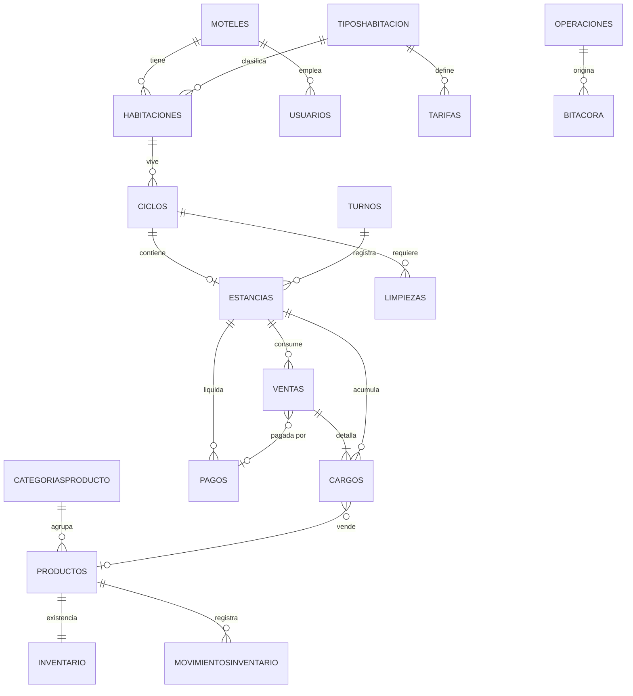
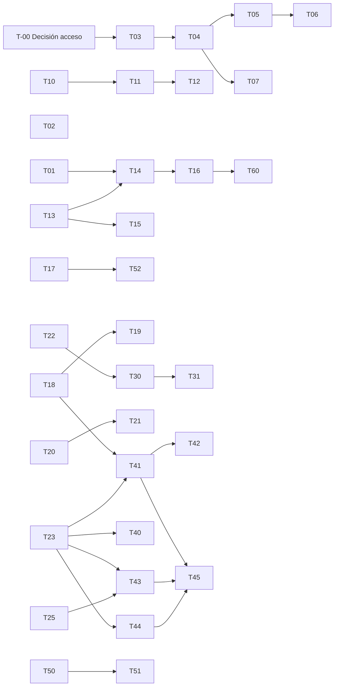

# Auditoría FEMA — Datos, flujo de ejecución e interfaz (2026-11-07)

> **Propósito.** Diagnóstico del estado actual de FEMA Motel ERP y plan de mejora ejecutable por un modelo ligero (Gemini 3.8 Flash), con tareas atómicas, archivos exactos, criterios de aceptación y verificación.
>
> **Base revisada:** rama `codex/adopt-arc-v1.3.2`, commit `c942d7a`, deployment estable `@43`.
> **Clasificación ARC v1.3.2:** modo *Auditoría/Planeación*, nivel *Alto* (toca auth, persistencia, pagos e inventario). Este documento **no** autoriza escrituras en Sheets, `clasp push` ni despliegues.

---

## 0. Cómo usar este documento (instrucciones para el agente ejecutor)

1. Ejecuta **una tarea por sesión**, en el orden de la sección 7. No combines tareas.
2. Antes de empezar, lee: `AGENTS.md`, esta auditoría (sólo la tarea + secciones referenciadas) y los archivos listados en la tarea.
3. Las tareas marcadas **🔒 DECISIÓN HUMANA** no se implementan hasta que el responsable elija una opción y quede registrada en `project-methodology/DECISIONS.md`.
4. Nunca ejecutes `npm run clasp:push`, `npm run clasp:deploy`, `clasp deploy` ni escribas en Google Sheets reales. Sólo cambios locales.
5. Al terminar cada tarea ejecuta, desde la raíz:
   ```bash
   npm run typecheck && npm run build && node local/smoke.mjs && git diff --check
   ```
   Si alguno falla, corrige antes de declarar la tarea terminada.
6. Entrega: lista de archivos cambiados, resultado de los 4 comandos y qué criterio de aceptación se verificó manualmente (si aplica, con `npm run dev:docker`).
7. No elimines comentarios ni documentación ajena. No renombres funciones `api*` existentes salvo que la tarea lo indique (el cliente las invoca por nombre).

---

## 1. Resumen ejecutivo

| # | Hallazgo | Severidad | Área |
|---|---|---|---|
| H1 | Acceso público anónimo + `getCurrentUser_()` toma `users[0]` cuando no hay correo: **cualquier persona con la URL opera como el primer usuario activo** (posiblemente administrador), con todos sus permisos. | 🔴 Crítica | Seguridad |
| H2 | Funciones de inventario y ventas (`saveProduct_`, `transferInventory_`, `adjustInventory_`, `registerSaleToRoom_`) **no llaman `assertPermission_`** ni usan idempotencia. Un doble clic o reintento de red duplica ventas y descuentos de stock. | 🔴 Crítica | Seguridad / Datos |
| H3 | `registerExit_` libera la habitación **sin revisar cargos pendientes** (consumos "a cuenta"). Riesgo directo de fuga de ingresos. | 🔴 Crítica | Flujo de negocio |
| H4 | `apiGetInitialState` (lectura) ejecuta `seedMenuIfEmpty_` y `healProductsSheet_` (escrituras) en **cada carga**. Lecturas con efectos secundarios. | 🟠 Alta | Flujo de ejecución |
| H5 | La idempotencia se busca recorriendo toda la `Bitacora` comparando la columna humana `Motivo`. Crece O(n) y mezcla semánticas. | 🟠 Alta | Datos / Rendimiento |
| H6 | `readRows_` lee la hoja completa en cada llamada (se repite varias veces por petición) y `updateRowById_` escribe **celda por celda**. Lento y amplía la ventana de escrituras parciales. | 🟠 Alta | Rendimiento / Integridad |
| H7 | La venta devuelve un `idCargo` que **no existe** en `Cargos` (cada renglón genera su propio ID); no hay cabecera de venta que agrupe renglones ni `IdProducto`/`IdMotel` en `Cargos`. | 🟠 Alta | Modelo de datos |
| H8 | UI sobrecargada: 14 diálogos, 84 botones estáticos, ~80 estilos en línea, emojis como iconos, diálogo de acciones de habitación con **8 botones**, inventario con **3 botones por fila** (~200 botones con 68 productos), dos puntos de entrada para venta. | 🟠 Alta | UX |
| H9 | Fechas mezcladas: `Date` nativo en habitaciones/estancias y `toISOString()` (UTC) en inventario. Reportes por día pueden desfasarse 6 h. | 🟡 Media | Datos |
| H10 | Categorías de producto como texto libre; `saveProduct_` escribe alias duplicados (`Categoría`, `Producto`, `NombreProducto`). | 🟡 Media | Datos |

**Visión de producto (una frase):** *La habitación es el centro. Un toque en la tarjeta abre exactamente la acción que ese estado necesita; todo lo demás se esconde hasta que se pide.*

---

## 2. Hallazgos detallados con evidencia

### H1 — Identidad anónima con privilegios
- Evidencia: [`03_Authorization.ts` L13-L19](../src/server/03_Authorization.ts) usa `users[0]` como respaldo; `appsscript.json` declara `ANYONE_ANONYMOUS` + `USER_DEPLOYING`.
- Efecto: `Session.getActiveUser()` devuelve vacío para anónimos → todos son el mismo usuario. `canOperate` del turno, la bitácora y los permisos pierden significado. Relacionado con FEMA-002, FEMA-008 y FEMA-015 del [TODO](TODO.md).
- Recomendación: login propio por **PIN de recepcionista** con sesión firmada (ver T-03…T-07). Mientras no exista, el acceso público sólo debería ser aceptable en una red controlada; documentarlo como riesgo aceptado o revertir a acceso con cuenta Google.

### H2 — Inventario sin permisos ni idempotencia
- Evidencia: [`08_InventoryService.ts` L245-L592](../src/server/08_InventoryService.ts): ninguna llamada a `assertPermission_`; sin `idempotencyKey`.
- Recomendación: permisos `PER-INV-GEST` (altas, precios, ajustes, traspasos) y `PER-VTA-REG` (ventas); `idempotencyKey` obligatoria en todas las mutaciones.

### H3 — Salida sin cuenta
- Evidencia: [`04_RoomService.ts` `registerExit_` L439-L480](../src/server/04_RoomService.ts) no consulta `Cargos`/`Pagos`.
- Recomendación: introducir **"Cuenta de la estancia"** (renta + consumos − pagos = saldo). La salida pasa a ser **"Cobrar y liberar"**: si saldo > 0, el mismo panel cobra el saldo y libera en un paso.

### H4 — Lecturas con escritura
- Evidencia: [`05_WebApp.ts` L11](../src/server/05_WebApp.ts) `seedMenuIfEmpty_(...)` dentro de `apiGetInitialState`.
- Recomendación: mover siembra/reparación a una acción administrativa explícita (`apiAdminRepairSchema`) protegida por permiso.

### H5 — Idempotencia sobre Bitácora
- Evidencia: patrón `readRows_(audit).find(row => row.Motivo === key)` repetido en 10+ funciones de `04_RoomService.ts`.
- Recomendación: hoja `Operaciones` (ya propuesta en [FEMA-UPD-03](FEMA_UPD03_SCHEMA_RECOVERY.md)) con `IdOperacion = idempotencyKey`, más helper único `runIdempotent_()`.

### H6 — Acceso a Sheets ineficiente
- Evidencia: [`02_SheetRepository.ts`](../src/server/02_SheetRepository.ts) `readRows_` sin caché; `updateRowById_` hace `setValue` por columna (L101-L105).
- Recomendación: caché por ejecución con invalidación en escritura; escribir la fila completa con un único `setValues`.

### H7 — Ventas sin cabecera
- Evidencia: `cargoId` (L514) se usa en la bitácora y en la respuesta, pero cada renglón de `Cargos` recibe `newId_("CRG")` distinto (L546).
- Recomendación: hoja `Ventas` (cabecera) + columnas aditivas en `Cargos`: `IdMotel`, `IdVenta`, `IdProducto`.

### H8 — Interfaz (ver sección 4)

### H9 — Fechas
- Evidencia: `now_().toISOString()` en `08_InventoryService.ts`; `now_()` (Date) en `04_RoomService.ts`.
- Recomendación: un solo helper `nowCell_()` que escriba `Date` (Sheets lo guarda en zona del libro) y `formatIso_()` para respuestas.

### H10 — Categorías libres y alias
- Evidencia: `saveProduct_` L277-L281.
- Recomendación: hoja `CategoriasProducto` (orden, activo) y eliminar alias.

---

## 3. Modelo de datos

### 3.1 Diagnóstico general
- 24 hojas, cabeceras en fila 4, datos desde fila 5. Integridad garantizada sólo por código.
- Positivo: separación `Ciclos` / `Estancias` / `EventosHabitacion`; bitácora con antes/después; lock global.
- Débil: no hay cabecera de venta, ni cuenta por estancia, ni journal de operaciones, ni catálogo de categorías; `Cargos`/`Pagos` sin `IdMotel`; `Inventario` 1:1 con `Productos` sin unicidad verificada.

### 3.2 Cambios propuestos (todos **aditivos**: no se borran ni renombran columnas existentes)

| Hoja | Cambio | Motivo |
|---|---|---|
| `Operaciones` (nueva) | `IdOperacion`, `IdMotel`, `Tipo`, `Estado` (`EN_CURSO`/`CONFIRMADA`/`FALLIDA`), `ResultadoJSON`, `IdUsuario`, `FechaHora` | Idempotencia y recuperación (H5). Alineada con FEMA-UPD-03. |
| `Ventas` (nueva) | `IdVenta`, `IdMotel`, `IdEstancia`, `IdTurno`, `Total`, `Items`, `Estado` (`A_CUENTA`/`PAGADA`/`CANCELADA`), `IdPago`, `IdUsuario`, `FechaHora` | Agrupar renglones (H7). |
| `Cargos` | + `IdMotel`, `IdVenta`, `IdProducto` | Trazabilidad producto→cargo→venta. |
| `Pagos` | + `IdMotel`, `Concepto` (`RENTA`/`CONSUMO`/`SALDO_SALIDA`) | Corte por forma de pago y concepto. |
| `CategoriasProducto` (nueva) | `IdCategoria`, `IdMotel`, `Nombre`, `Orden`, `Activo` | Orden fijo del menú; sin texto libre (H10). |
| `Productos` | + `IdCategoria`, `StockMinimo` | Relación formal y alerta de bajo stock. Mantener `Categoria` (texto) como legado de lectura. |
| `Usuarios` | + `PinHash`, `PinSalt`, `PinActualizadoEn`, `IntentosFallidos`, `BloqueadoHasta` | Login por PIN (H1). **Nunca** PIN en claro. |
| `Sesiones` | usar columnas existentes + `TokenHash`, `ExpiraEn` | Sesión firmada para acceso público. |
| `Permisos` / `RolPermisos` | filas `PER-INV-GEST`, `PER-VTA-REG`, `PER-REP-VER`, `PER-ADM` | Matriz mínima (FEMA-015). Requiere autorización para escribir en la hoja real. |

### 3.3 Relaciones objetivo



### 3.4 Invariantes que el código debe validar
1. Una habitación `OCUPADA` tiene exactamente una `Estancia` `ACTIVA` cuyo `IdCiclo = Habitaciones.IdCicloActual`.
2. `Inventario` tiene una sola fila por (`IdMotel`, `IdProducto`). Stock nunca < 0.
3. `Σ Cargos.Total (IdVenta)` = `Ventas.Total`.
4. **Saldo de estancia** = `PrecioFinal` + `Σ Cargos PENDIENTE/COBRADO` − `Σ Pagos APLICADO`. No se puede liberar con saldo > 0 (salvo permiso de cortesía con motivo).
5. Toda mutación tiene una fila en `Operaciones` y al menos una en `Bitacora`.

---

## 4. Auditoría de interfaz (UI/UX)

### 4.1 Inventario de lo que hoy ve el usuario

| Zona | Elementos actuales | Problema |
|---|---|---|
| Header | Logo "FEMA" + título "FEMA Motel ERP" + subtítulo + reloj + píldora de sesión + botón de turno | Marca repetida 3 veces; subtítulo no aporta. |
| Navegación | Habitaciones · Inventario · Reporte de rentas · Catálogos · **🛒 Registrar Venta** | 5 destinos al mismo nivel; Catálogos es tarea de administración poco frecuente; venta duplicada (también en la habitación). |
| Habitación ocupada | Diálogo con 7 botones: venta, salida, persona extra, editar renta, cambio, cancelar, (deshacer) | Todas las opciones pesan igual; textos largos con paréntesis y emojis; ninguna acción principal clara. |
| Habitación sucia | 2 botones (asignar camarista, deshacer) → luego otro diálogo para elegir camarista | 3 clics para una acción de 1 decisión. |
| Habitación en limpieza | 2 botones (finalizar, deshacer) | Diálogo intermedio innecesario. |
| Entrada | 6 controles: tarifa (select), medio llegada (select), forma de pago (select), marca/modelo, placas, persona extra | Selects ocultan opciones; tarifa es lo más importante y queda en un desplegable. |
| Inventario | 4 botones de cabecera + 4 tarjetas métricas + 10 chips + buscador + tabla 8 columnas + 3 botones por fila | Muro de controles; acciones repetidas 68 veces. |
| Venta | Modal grande: selector de habitación + chips + buscador + grid + carrito + tipo de pago + forma de pago | Correcto en contenido, pero vive desconectado de la habitación. |
| Feedback | Modal bloqueante de carga en **cada** llamada; toasts | El modal bloqueante hace sentir lenta la app aunque la llamada tarde 300 ms. |

### 4.2 Principios de diseño adoptados (estilo Jobs)
1. **Una pantalla, un propósito; un estado, una acción principal.** Cada panel tiene un solo botón primario.
2. **Divulgación progresiva.** Lo frecuente visible; lo raro detrás de "Más" (`⋯`).
3. **Un toque.** Las decisiones de una sola opción se resuelven tocando la opción (no "elegir + confirmar").
4. **Deshacer en lugar de confirmar.** Acciones reversibles se ejecutan al instante con un toast "Deshacer" de 6 s. Confirmación explícita sólo para dinero y cancelaciones.
5. **Valores por defecto inteligentes.** Tarifa más usada preseleccionada, "Vehículo" y "Efectivo" por defecto, placas en mayúsculas automáticas.
6. **El color significa estado.** Sólo las tarjetas de habitación usan color de estado; el resto de la interfaz es neutra (blanco, grises, un acento).
7. **Sin ruido.** Sin emojis, sin paréntesis explicativos en botones, sin texto que repita lo que el icono ya dice.

### 4.3 Arquitectura de información propuesta

```text
┌───────────────────────────────────────────────────────────────┐
│ FEMA        Habitaciones   Tienda   Corte          12:41  ● Turno de Ana  ⚙ │
└───────────────────────────────────────────────────────────────┘
```

- **Barra única** (56 px): marca corta "FEMA", 3 pestañas, reloj, píldora de turno (tocar = abrir/cerrar turno), engrane (⚙) visible sólo con `PER-CAT-GEST` → Catálogos, Reparar esquema, Cerrar sesión.
- **Habitaciones** (inicio): sólo el tablero. Resumen de estados como texto discreto bajo la barra sólo si aporta (opcional).
- **Tienda** (antes Inventario): lista limpia de productos; las operaciones viven dentro del producto.
- **Corte** (antes Reporte de rentas): resumen del turno (rentas, consumos, efectivo, tarjeta) + detalle.
- Se elimina el botón global "Registrar Venta": vender es una acción **de la habitación ocupada**.

### 4.4 Flujo por estado de habitación (objetivo de clics)

```mermaid
stateDiagram-v2
  [*] --> Disponible
  Disponible --> Ocupada: Toque → Panel Entrada → "Entrada $350" (2-3 toques)
  Ocupada --> Ocupada: Toque → Panel Cuenta → "Agregar consumo" (toque por producto)
  Ocupada --> Sucia: Panel Cuenta → "Cobrar y liberar" (1 toque si saldo 0; 2 si hay saldo)
  Sucia --> Limpieza: Toque → lista de camaristas → toque en nombre (2 toques)
  Limpieza --> Disponible: Toque → "Terminar limpieza" (2 toques) + toast Deshacer
```



| Estado | Hoy (clics) | Objetivo | Panel |
|---|---|---|---|
| Disponible → entrada | 4-8 | 2-3 | Panel lateral "Entrada" |
| Ocupada → vender 2 productos | 6+ (y elegir habitación otra vez desde nav) | 3 | Panel "Cuenta" con tienda embebida |
| Ocupada → salida | 2-3 | 1-2 | Botón primario del panel "Cuenta" |
| Sucia → limpieza | 3-4 | 2 | Panel "Camaristas" |
| Limpieza → disponible | 2-3 | 2 | Panel mínimo con 1 botón |

### 4.5 Especificación de paneles

**Componente base `Sheet`** (panel lateral derecho de 420 px en escritorio, hoja inferior en móvil; implementado con `<dialog>`): título, subtítulo opcional, cuerpo, pie con **un** botón primario a todo lo ancho y un enlace secundario "Más ⋯". Reemplaza los 14 diálogos actuales.

**Panel Entrada (habitación disponible)**
1. Título: `Habitación 12` · subtítulo `Sencilla`.
2. Tarifas como **botones segmentados grandes** (`3 h · $350`, `6 h · $500`, `12 h · $700`); la primera seleccionada.
3. Llegada: 3 botones con icono (auto, taxi, a pie). "Auto" por defecto. Si auto → campo placas (mayúsculas automáticas) y marca/modelo con sugerencias.
4. Personas extra: stepper `− 0 +` en una línea.
5. Pago: toggle `Efectivo | Tarjeta`.
6. Botón primario: **`Registrar entrada · $350`** (el total vive en el botón; se elimina el bloque resumen).

**Panel Cuenta (habitación ocupada)**
1. Cabecera: número, tiempo restante grande (`1:42 restantes`), placas.
2. Lista de cuenta: `Renta 3 h  $350`, consumos agrupados, pagos; **Saldo** en grande.
3. Botón secundario ancho: `Agregar consumo` → expande en el mismo panel la cuadrícula de productos (chips de categoría + buscador); cada toque agrega 1 unidad; stepper en la lista de cuenta.
4. Botón primario: `Liberar` (saldo 0) o `Cobrar $120 y liberar` (saldo > 0, con toggle Efectivo/Tarjeta).
5. "Más ⋯": Persona extra · Extender tiempo · Editar datos · Cambiar habitación · Cancelar renta (rojo, con confirmación y motivo).

**Panel Camaristas (habitación sucia)**: lista de camaristas del turno como filas grandes; tocar un nombre asigna e inicia limpieza, cierra el panel y muestra toast `Limpieza iniciada · Deshacer`.

**Panel Limpieza**: nombre de camarista y minutos transcurridos; botón primario `Terminar limpieza`; toast con `Deshacer`.

**Tienda**
- Una línea de estado: `68 productos · 3 con bajo stock · 0 agotados` (cada número es filtro).
- Chips de categoría + buscador en una sola fila. Botón `+` (nuevo producto) a la derecha.
- Tabla de 4 columnas: Producto (nombre + categoría en gris), Precio, Anaquel, Bodega. Sin botones en filas.
- Tocar fila → Sheet "Producto": nombre/precio editables en línea; dos bloques Anaquel/Bodega con stepper; acción `Pasar de bodega a anaquel` con cantidad; `Corregir conteo` (pide motivo); pestaña `Movimientos` del producto.

### 4.6 Sistema visual
- Tipografía: `-apple-system, "SF Pro Text", "Inter", system-ui`; tamaños 13/15/17/22/34; pesos 400/600.
- Espaciado: rejilla de 8 px; radios 12 px (tarjetas) y 10 px (botones).
- Color neutro: fondo `#F5F5F7`, superficie `#FFFFFF`, texto `#1D1D1F`, secundario `#6E6E73`, línea `#E5E5EA`, acento `#0071E3`.
- Estados de habitación (únicos colores saturados): Disponible `#34C759`, Ocupada `#FF3B30`, Sucia `#FF9F0A`, Limpieza `#0A84FF`, Vencida `#AF52DE`.
- Botones: sólo dos estilos — primario (relleno acento) y secundario (texto acento sin borde). Destructivo = texto rojo.
- Iconos: sprite SVG de trazo 1.5 px (auto, taxi, peatón, carrito, escoba, check, más, engrane, deshacer, cerrar). Sin emojis.
- Movimiento: transiciones de 200 ms `ease-out`; panel entra deslizándose; respeta `prefers-reduced-motion`.

---

## 5. Flujo de ejecución (técnico)

| Hoy | Propuesta |
|---|---|
| `apiGetInitialState` lee todo y además siembra/repara productos. | `apiBootstrap` sólo lectura: usuario, habitaciones, tarifas, camaristas, turno. Inventario y catálogos se cargan al abrir su pestaña. |
| Modal bloqueante en cada llamada. | Estado *busy* en el botón; modal sólo si la llamada supera 600 ms; UI optimista para limpieza y asignación. |
| Sin refresco entre terminales. | Refresco silencioso del tablero cada 30 s cuando la pestaña está visible (`visibilitychange`), sin parpadeo. |
| Cada servicio repite `readRows_` de las mismas hojas. | Caché por ejecución en `02_SheetRepository.ts`, invalidada por hoja al escribir. |
| Idempotencia en bitácora. | `runIdempotent_(key, tipo, fn)` sobre `Operaciones`; devuelve el resultado guardado si la operación ya se confirmó. |
| Escrituras celda por celda. | `updateRowById_` escribe la fila completa en un `setValues`. |

---

## 6. Riesgos y fuera de alcance
- No se propone migrar de stack (Apps Script + Sheets se mantiene).
- Cambios de esquema en el libro real requieren autorización explícita y respaldo previo (ver FEMA-UPD-03). El código debe **leer** columnas nuevas de forma tolerante (si faltan, comportamiento anterior) hasta que la hoja se migre.
- Políticas monetarias (FEMA-006, FEMA-014) siguen abiertas; las tareas de cuenta/salida no deben modificar pagos históricos.

---

## 7. Plan de tareas para Gemini 3.8 Flash

**Leyenda:** Tamaño S (≤ 1 h, 1 archivo), M (≤ 3 h, 2-3 archivos). Dependencias por ID. Comandos de verificación estándar = los de la sección 0, paso 5.

### Fase 0 — Decisiones y seguridad

#### T-00 🔒 DECISIÓN HUMANA — Modelo de acceso
- **Opciones:** (A) Volver a acceso con cuenta Google (`ANYONE` + `USER_ACCESSING`/dominio). (B) Mantener acceso público y agregar login por PIN (T-03…T-07). (C) Aceptar riesgo temporal documentado.
- **Entregable:** entrada en `DECISIONS.md`. Recomendado: **B**.

#### T-01 Permisos en inventario y ventas — S
- **Archivos:** `src/server/08_InventoryService.ts`, `local/seed-data.mjs`.
- **Pasos:**
  1. Al inicio de `saveProduct_`, `transferInventory_`, `adjustInventory_` añade `assertPermission_(user, "PER-INV-GEST");`.
  2. Al inicio de `registerSaleToRoom_` añade `assertPermission_(user, "PER-VTA-REG");`.
  3. En `getProductsAndInventory_`, `getInventoryMovements_`, `getOccupiedRoomsForSale_` añade `assertPermission_(user, "PER-HAB-GEST");`.
  4. En `local/seed-data.mjs` agrega filas `Permisos` y `RolPermisos` para `PER-INV-GEST` y `PER-VTA-REG` en los roles que ya tienen `PER-HAB-GEST`.
- **Aceptación:** un rol sin el permiso recibe `No tienes el permiso requerido: PER-INV-GEST`; smoke pasa.
- **Nota:** agregar esas filas en la hoja real es una operación externa que requiere autorización.

#### T-02 Quitar escrituras de la carga inicial — S
- **Archivos:** `src/server/05_WebApp.ts`, `src/server/08_InventoryService.ts`.
- **Pasos:**
  1. Elimina la llamada `seedMenuIfEmpty_(...)` de `apiGetInitialState`.
  2. Crea `apiAdminRepairInventory()` que llama `assertPermission_(user, "PER-CAT-GEST")`, luego `healProductsSheet_` y `seedMenuIfEmpty_` dentro de `withScriptLock_`, y devuelve `{ ok: true, data: { productos: n } }`.
  3. Verifica que `getProductsAndInventory_` no llame a funciones de siembra; si lo hace, elimina esa llamada.
- **Aceptación:** `apiGetInitialState` no invoca ninguna función que escriba (revisar con búsqueda de `appendRow_|updateRowById_|setValues` en la ruta de llamada).

#### T-03 Hash de PIN (depende de T-00 = B) — S
- **Archivo nuevo:** `src/server/09_PinAuth.ts`.
- **Pasos:** implementa `hashPin_(pin: string, salt: string): string` con `Utilities.computeDigest(SHA_256, salt + ":" + pin)` iterado 1000 veces y codificado base64; `newSalt_()` con `Utilities.getUuid()`; `isValidPinFormat_(pin)` = 6 dígitos.
- **Aceptación:** función pura; añade mock de `Utilities.computeDigest` en `local/harness.mjs` si falta.

#### T-04 Sesiones con token — M (depende de T-03)
- **Archivos:** `09_PinAuth.ts`, `02_SheetRepository.ts` (`DEFAULT_SHEET_HEADERS_` para `Sesiones` con `TokenHash`, `ExpiraEn`).
- **Pasos:** `apiLogin(idUsuario, pin)` valida PIN, bloquea 5 min tras 5 intentos (`IntentosFallidos`, `BloqueadoHasta`), crea fila en `Sesiones` con `TokenHash = hashPin_(token, "session")` y `ExpiraEn` = ahora + 12 h; devuelve token en claro una sola vez. `apiLogout(token)`. `apiListLoginUsers()` devuelve sólo `idUsuario` + nombre de usuarios activos.
- **Aceptación:** PIN incorrecto no crea sesión; token caduca.

#### T-05 `getCurrentUser_` por token — M (depende de T-04)
- **Archivos:** `03_Authorization.ts`, `05_WebApp.ts`.
- **Pasos:** cada `api*` recibe como último parámetro opcional `token`; `getCurrentUser_(token)` resuelve la sesión activa no expirada; si no hay token válido lanza `SESION_REQUERIDA`. **Eliminar el respaldo `users[0]`.** Actualiza `FEMA_ERROR` para incluir `code: "SESION_REQUERIDA"`.
- **Aceptación:** sin token → error `SESION_REQUERIDA`; smoke actualizado para iniciar sesión primero.

#### T-06 Pantalla de bloqueo — M (depende de T-05)
- **Archivo:** `src/client/Index.html`.
- **Pasos:** pantalla completa minimalista: lista de nombres (botones grandes) → teclado numérico de 6 dígitos → entra. Guarda el token en `sessionStorage`. `callApi` añade el token; si recibe `SESION_REQUERIDA` vuelve a la pantalla de bloqueo. Botón "Bloquear" en el menú ⚙.
- **Aceptación:** sin sesión no se ve el tablero; recarga mantiene la sesión durante la pestaña.

#### T-07 Gestión de PIN en Catálogos — S (depende de T-04)
- **Archivos:** `06_CatalogService.ts`, `Index.html`.
- **Pasos:** `apiSetUserPin(idUsuario, pin)` con `PER-CAT-GEST`; en la tabla de recepcionistas, acción "Definir PIN". Nunca devolver `PinHash` al cliente.

### Fase 1 — Capa de datos firme

#### T-10 Caché por ejecución — S
- **Archivo:** `src/server/02_SheetRepository.ts`.
- **Pasos:** `const ROWS_CACHE_: Record<string, SheetRow[]> = {};` `readRows_` consulta y llena la caché; `appendRow_` y `updateRowById_` hacen `delete ROWS_CACHE_[sheetName]`. Devuelve copias superficiales (`map(r => ({...r}))`) para evitar mutaciones compartidas.
- **Aceptación:** smoke pasa; `local/concurrency.mjs` pasa.

#### T-11 Escritura de fila completa — S
- **Archivo:** `02_SheetRepository.ts`.
- **Pasos:** en `updateRowById_`, lee la fila actual (`getRange(rowNumber,1,1,lastColumn).getValues()[0]`), aplica el `patch` por índice y escribe con un solo `setValues`. Conserva el error si una columna no existe.

#### T-12 Fechas uniformes — S
- **Archivos:** `02_SheetRepository.ts`, `08_InventoryService.ts`.
- **Pasos:** crea `formatIso_(d: Date): string` con `Utilities.formatDate(d, FEMA_CONFIG.timeZone, "yyyy-MM-dd'T'HH:mm:ssXXX")`. En `08_InventoryService.ts` reemplaza `now_().toISOString()` por `now_()` al escribir y usa `formatIso_` al devolver.

#### T-13 Hoja `Operaciones` y `runIdempotent_` — M
- **Archivos:** `00_Config.ts` (`operations: "Operaciones"`), `02_SheetRepository.ts` (cabeceras), archivo nuevo `src/server/10_Operations.ts`, `local/seed-data.mjs`.
- **Pasos:** `runIdempotent_<T>(user, key, tipo, fn: () => T): T` — valida `key` (1-160 chars); si existe fila `CONFIRMADA` devuelve `JSON.parse(ResultadoJSON)`; si existe `EN_CURSO` lanza "Operación en proceso, actualiza el tablero"; si no, escribe `EN_CURSO`, ejecuta `fn`, actualiza a `CONFIRMADA` con resultado; en excepción marca `FALLIDA` y relanza. Debe ejecutarse dentro de `withScriptLock_`.
- **Aceptación:** llamar dos veces con la misma clave ejecuta `fn` una sola vez (añadir caso a `local/smoke.mjs`).

#### T-14 Idempotencia en inventario y ventas — M (depende de T-13)
- **Archivos:** `01_Types.ts` (añadir `idempotencyKey: string` a `SaveProductInput`, `TransferInventoryInput`, `AdjustInventoryInput`, `RegisterSaleInput`), `08_InventoryService.ts`, `Index.html` (generar clave con `crypto.randomUUID()` al abrir cada formulario).
- **Aceptación:** doble clic en "Confirmar venta" registra una sola venta.

#### T-15 Migrar idempotencia de habitaciones — M (depende de T-13)
- **Archivo:** `04_RoomService.ts`.
- **Pasos:** sustituye cada bloque `readRows_(audit).find/some(... Motivo === key)` por `runIdempotent_`. Mantén `writeAudit_` igual. Una función por commit lógico; corre smoke tras cada una.

#### T-16 Ventas con cabecera — M
- **Archivos:** `00_Config.ts` (`sales: "Ventas"`), `02_SheetRepository.ts` (cabeceras `Ventas`; `Cargos` + `IdMotel`,`IdVenta`,`IdProducto`; `Pagos` + `IdMotel`,`Concepto`), `08_InventoryService.ts`, `local/seed-data.mjs`.
- **Pasos:** `registerSaleToRoom_` crea `IdVenta` único, escribe todos los `Cargos` con ese `IdVenta`, el `IdProducto` y `IdMotel`; escribe fila `Ventas`; si cobro inmediato, `Pagos.Concepto = "CONSUMO"` y `Ventas.IdPago`. Devuelve `idVenta` (mantén `idCargo` = `idVenta` por compatibilidad del cliente).
- **Aceptación:** `Σ Cargos.Total` por `IdVenta` = `Ventas.Total` (caso en smoke).

#### T-17 Categorías como catálogo — M
- **Archivos:** `00_Config.ts`, `02_SheetRepository.ts`, `08_InventoryService.ts`, `local/seed-data.mjs`.
- **Pasos:** hoja `CategoriasProducto` con las 9 categorías del menú en su orden (Sex-Shop, Farmacia, Alimentos, Dulcería, Cigarros, Botana, Cerveza, Bebidas, Vinos). `Productos.IdCategoria`. Lectura tolerante: si falta `IdCategoria`, usar `Categoria` texto. Elimina las claves alias `Categoría`, `Producto`, `NombreProducto` de `saveProduct_`. Devuelve categorías ordenadas en `getProductsAndInventory_`.

#### T-18 Cuenta de estancia — M
- **Archivos:** `01_Types.ts` (`StayAccount`), archivo nuevo `src/server/11_StayAccount.ts`, `05_WebApp.ts` (`apiGetStayAccount(idHabitacion)`).
- **Pasos:** devuelve `{ renta, personasExtra, consumos: [{descripcion,cantidad,total,estado}], pagos: [{formaPago,monto,concepto}], saldo }`. Saldo según invariante 4 de la sección 3.4. Sólo lectura.
- **Aceptación:** caso en smoke: renta pagada + venta a cuenta $80 → saldo 80.

#### T-19 Salida con cobro de saldo — M (depende de T-18) — 🔒 confirmar política de cortesías
- **Archivos:** `01_Types.ts` (`ExitInput` + `cobro?: { formaPago: string; monto: number }`), `04_RoomService.ts`.
- **Pasos:** en `registerExit_` calcula saldo; si saldo > 0 y no viene `cobro` con `monto === saldo` → error "La habitación tiene saldo pendiente de $X". Si viene, inserta `Pagos` (`Concepto = "SALDO_SALIDA"`) y marca los `Cargos PENDIENTE` de la estancia como `COBRADO`, todo antes de cambiar estado de habitación.
- **Aceptación:** no se puede liberar con saldo; con cobro, saldo queda en 0 y la habitación pasa a `SUCIA`.

### Fase 2 — Fundamentos de interfaz

#### T-20 Tokens de diseño — S
- **Archivo:** `Index.html` (bloque `:root`).
- **Pasos:** define las variables de la sección 4.6 (`--bg`, `--surface`, `--text`, `--text-2`, `--line`, `--accent`, `--st-free`, `--st-busy`, `--st-dirty`, `--st-clean`, `--st-late`, `--r-card`, `--r-btn`, `--s-1..--s-6` = 4/8/12/16/24/32 px). Sustituye colores literales repetidos por variables. Sin cambio visual intencionado salvo la paleta.

#### T-21 Eliminar estilos en línea — M (depende de T-20)
- **Archivo:** `Index.html`.
- **Pasos:** cada `style="..."` del HTML estático y de las plantillas JS pasa a una clase utilitaria con nombre semántico (`.row`, `.grow`, `.muted-sm`, `.scroll-55`). Meta: `grep -c 'style="' src/client/Index.html` ≤ 5.

#### T-22 Sprite de iconos SVG — S
- **Archivo:** `Index.html`.
- **Pasos:** `<svg hidden>` con `<symbol>`: `i-car`, `i-taxi`, `i-walk`, `i-cart`, `i-broom`, `i-check`, `i-more`, `i-gear`, `i-undo`, `i-close`, `i-plus`, `i-minus`. Helper JS `icon(name)` → `<svg class="ic"><use href="#i-name"/></svg>`. Reemplaza **todos** los emojis en botones y títulos.
- **Aceptación:** `grep -P "[\x{1F300}-\x{1FAFF}\x{2600}-\x{27BF}]" src/client/Index.html` sin resultados.

#### T-23 Componente `Sheet` — M
- **Archivo:** `Index.html`.
- **Pasos:** un único `<dialog id="sheet" class="sheet">` con zonas `header/body/footer`. API JS: `openSheet({ title, subtitle, body: HTMLElement|string, primary: { label, onClick, tone }, more: [{label, onClick, danger}] })`, `closeSheet()`. Panel lateral derecho ≥ 768 px; hoja inferior < 768 px; cierre con Esc y clic fuera; foco al primer control; `prefers-reduced-motion`.
- **Aceptación:** demostrado migrando el diálogo de limpieza (T-44) sin regresiones.

#### T-24 Carga no bloqueante — S
- **Archivo:** `Index.html` (función que envuelve `google.script.run`).
- **Pasos:** el botón que dispara la llamada recibe `aria-busy="true"` y se deshabilita; el modal `#loadingModal` sólo aparece si la llamada dura > 600 ms.

#### T-25 Toast con Deshacer — S
- **Archivo:** `Index.html`.
- **Pasos:** `notify(msg, { undo: fn, ms: 6000 })` muestra botón "Deshacer" que ejecuta `fn`. Toast abajo al centro, máximo uno visible.

### Fase 3 — Navegación

#### T-30 Barra superior única — S (depende de T-22)
- **Archivo:** `Index.html`.
- **Pasos:** fusiona `<header>` y `<nav>` en una barra de 56 px: "FEMA" (texto), pestañas `Habitaciones · Tienda · Corte`, reloj, píldora de turno, botón ⚙. Elimina título largo y subtítulo. Elimina `#navOpenSaleBtn`.

#### T-31 Menú ⚙ — S (depende de T-30)
- **Archivo:** `Index.html`.
- **Pasos:** popover (`popover` nativo) con: Catálogos, Reparar inventario (llama `apiAdminRepairInventory`), Bloquear/Cerrar sesión. Se oculta si el usuario no tiene `PER-CAT-GEST` (exponer lista de permisos del usuario en `apiGetInitialState`).

#### T-32 Refresco silencioso — S
- **Archivo:** `Index.html`.
- **Pasos:** cada 30 s, si `document.visibilityState === "visible"` y no hay `Sheet` abierto, recarga habitaciones sin modal ni parpadeo (diff por `idHabitacion`).

### Fase 4 — Flujos de habitación

#### T-40 Panel Entrada — M (depende de T-23)
- **Archivo:** `Index.html` (`openEntry`).
- **Pasos:** reconstruye el formulario según sección 4.5: tarifas como botones segmentados (`role="radiogroup"`), llegada con 3 iconos, placas con `text-transform: uppercase` y conversión a mayúsculas al enviar, stepper de personas extra, toggle de pago, botón primario con total dinámico `Registrar entrada · $X`. Mantén los mismos nombres de campos y `idempotencyKey` que hoy envía a `apiRegisterEntry`.
- **Aceptación:** entrada típica (auto, efectivo, tarifa por defecto) en ≤ 3 toques + placas.

#### T-41 Panel Cuenta — M (depende de T-18, T-23)
- **Archivo:** `Index.html`.
- **Pasos:** tocar habitación ocupada abre `Sheet` con datos de `apiGetStayAccount`: tiempo restante, lista de cuenta, saldo, botón secundario "Agregar consumo", primario "Liberar" / "Cobrar $X y liberar", menú "Más ⋯" con las acciones secundarias existentes (persona extra, editar, cambiar habitación, cancelar en rojo).
- **Aceptación:** `#roomActionsDialog` deja de usarse para habitaciones ocupadas.

#### T-42 Consumo embebido — M (depende de T-41, T-14)
- **Archivo:** `Index.html`.
- **Pasos:** "Agregar consumo" expande dentro del panel la cuadrícula de productos (reusa `renderSaleProducts`); habitación fija (sin selector); cada toque suma 1; carrito integrado en la lista de cuenta; botón "Cargar a la cuenta · $X". Retira `#saleModal` y `openSaleModal` cuando no queden referencias.

#### T-43 Camaristas en un toque — S (depende de T-23, T-25)
- **Archivo:** `Index.html`.
- **Pasos:** tocar habitación sucia abre `Sheet` con camaristas del turno como filas grandes; tocar nombre llama `apiAssignCleaning`, cierra y muestra toast con "Deshacer" (llama `apiUndoRoomState`).

#### T-44 Terminar limpieza — S (depende de T-23, T-25)
- **Archivo:** `Index.html`.
- **Pasos:** `Sheet` mínimo con camarista, minutos y primario "Terminar limpieza"; toast con "Deshacer".

#### T-45 Retirar `#roomActionsDialog` — S (depende de T-41, T-43, T-44)
- **Archivo:** `Index.html`. Elimina el diálogo y su render (L2380-L2415 aprox.) cuando ya no tenga usos.

#### T-46 Tiempo restante en tarjeta — S
- **Archivo:** `Index.html` (`refreshRoomClocks`).
- **Pasos:** en tarjetas ocupadas muestra `1:42` restante; al llegar a 0 cambia a estilo "Vencida" y muestra `+0:12`. Sin escrituras en servidor (FEMA-013).

### Fase 5 — Tienda

#### T-50 Tabla limpia — S
- **Archivo:** `Index.html` (render de inventario).
- **Pasos:** 4 columnas (Producto + categoría gris, Precio, Anaquel, Bodega); sin botones en filas; fila completa clicable (`role="button"`, Enter abre). Sustituye las 4 tarjetas métricas por una línea de texto con filtros clicables. Los 4 botones de cabecera se reducen a un `+`.

#### T-51 Sheet Producto — M (depende de T-23, T-50)
- **Archivo:** `Index.html`.
- **Pasos:** al tocar fila abre `Sheet` con: nombre y precio editables (guardar con `apiSaveProduct`), bloques Anaquel/Bodega, acción "Pasar a anaquel" con stepper (llama `apiTransferInventory`), "Corregir conteo" con motivo obligatorio (`apiAdjustInventory`), pestaña "Movimientos" filtrada por producto. Retira `#productEditorModal` (salvo para alta), `#transferStockModal`, `#adjustStockModal`, `#movementsModal`.

#### T-52 Bajo stock — S (depende de T-17 o columna `StockMinimo`)
- **Archivos:** `08_InventoryService.ts` (devolver `stockMinimo`, default 3), `Index.html` (punto naranja junto a Anaquel cuando `anaquel ≤ stockMinimo`; filtro "Bajo stock").

### Fase 6 — Corte

#### T-60 Corte de turno — M (depende de T-16)
- **Archivos:** `04_RoomService.ts` o nuevo `12_ShiftReport.ts`, `Index.html`.
- **Pasos:** resumen del turno activo o seleccionado (FEMA-003): rentas, consumos, total, efectivo, tarjeta, saldos pendientes; debajo el detalle actual. Sólo lectura.

### Fase 7 — Calidad y documentación

#### T-70 Cobertura de smoke — M
- **Archivo:** `local/smoke.mjs`.
- **Casos:** venta a cuenta y cobrada; doble envío con misma clave; traspaso con stock insuficiente; ajuste sin motivo; salida bloqueada por saldo; permiso denegado de inventario.

#### T-71 Documentación — S (al final de cada fase)
- **Archivos:** `ARCHITECTURE.md`, `design/COMPONENTS.md`, `design/LAYOUTS.md`, `design/TOKENS.md`, `TODO.md`. Actualiza sólo lo que cambió; marca hallazgos H1-H10 como resueltos con referencia a la tarea.

---

## 8. Orden sugerido y dependencias



**Ruta mínima de mayor impacto** (si sólo hay tiempo para 10 tareas): T-01, T-02, T-13, T-14, T-16, T-18, T-19, T-23, T-41, T-42.

## 9. Métricas de éxito
- Toques para entrada típica ≤ 3; venta de 2 productos ≤ 3; limpieza ≤ 2.
- Diálogos en el HTML: de 14 a ≤ 4 (`sheet`, `loading`, alta de producto, catálogos).
- Botones visibles en Tienda con 68 productos: de ~210 a ≤ 15.
- Emojis: 0. Estilos en línea: ≤ 5.
- Cero ventas duplicadas en prueba de doble envío; cero salidas con saldo > 0.
- `apiGetInitialState` sin escrituras.
